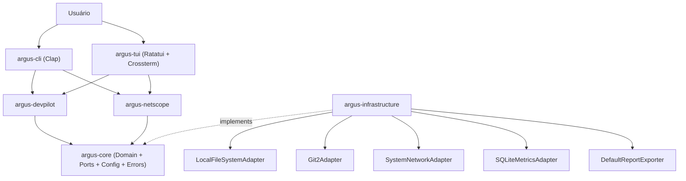

# Arquitetura do Projeto ARGUS

## 1. Estilo Arquitetural

O **Projeto ARGUS** adota **Arquitetura Hexagonal (Ports and Adapters)** combinada com **Monólito Modular** em um único Cargo Workspace.

Essa decisão entrega separação estrita entre regras de negócio e detalhes de infraestrutura sem introduzir a sobrecarga operacional de microsserviços em uma ferramenta local executada por um único usuário.

## 2. Diagrama de Camadas

## 3. Portas Hexagonais (`argus-core::ports`)

| Porta | Responsabilidade | Adaptador padrão |
|---|---|---|
| `FileSystemPort` | Varredura segura, leitura UTF-8 limitada e escrita protegida | `LocalFileSystemAdapter` |
| `GitRepositoryPort` | Inspeção somente leitura de branch, status e commits | `Git2Adapter` |
| `NetworkMonitorPort` | Interfaces, sockets TCP/UDP, latência e sondagens autorizadas | `SystemNetworkAdapter` |
| `MetricsRepositoryPort` | Histórico transacional, métricas, alertas e preferências | `SQLiteMetricsAdapter` |
| `ReportExporterPort` | Formatação JSON e Markdown | `DefaultReportExporter` |

## 4. Extensibilidade (DevPilot)

Novos analisadores internos podem implementar a trait `argus_devpilot::ProjectAnalyzer` e ser registrados no `AnalyzerRegistry` sem alterar o fluxo principal de análise.
